<p align="center">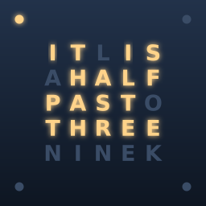</p>

<p align="center"><a href="https://ko-fi.com/missingfoss"></a></p>

# Literal Clock

A word clock screensaver for [Kiosk Satellite](https://github.com/jxlarrea/kiosk-satellite): a grid of letters where the words that tell the time light up, "IT IS TWENTY PAST FOUR", with four corner dots for the minutes in between.

<!-- screenshots:start -->
## Screenshots

<p align="center">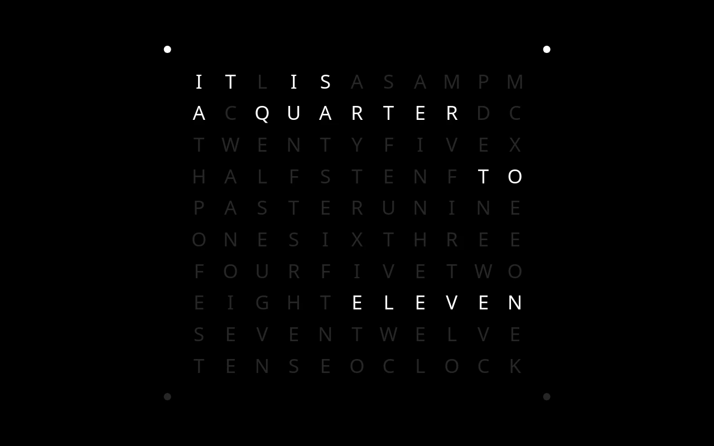<br><sub>Every setting at its default</sub></p>

<table>
<tr><td width="50%" valign="top">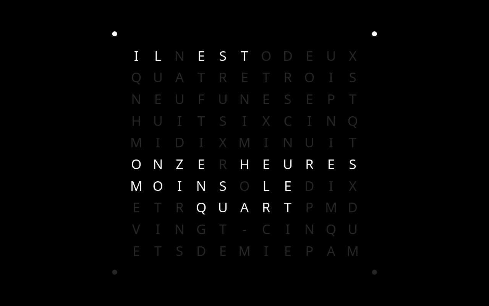<br><sub>Language: Français</sub></td><td width="50%" valign="top">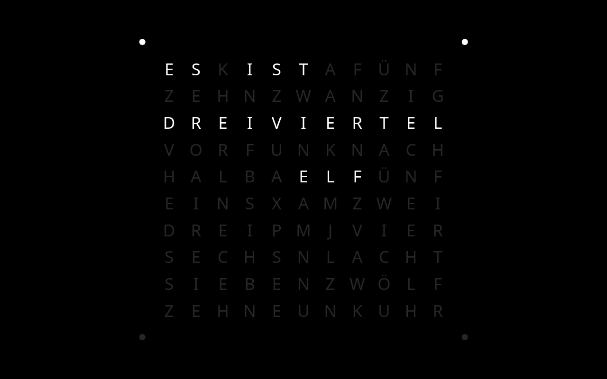<br><sub>Language: Deutsch · Quarter hours: viertel vier, dreiviertel vier</sub></td></tr>
<tr><td width="50%" valign="top">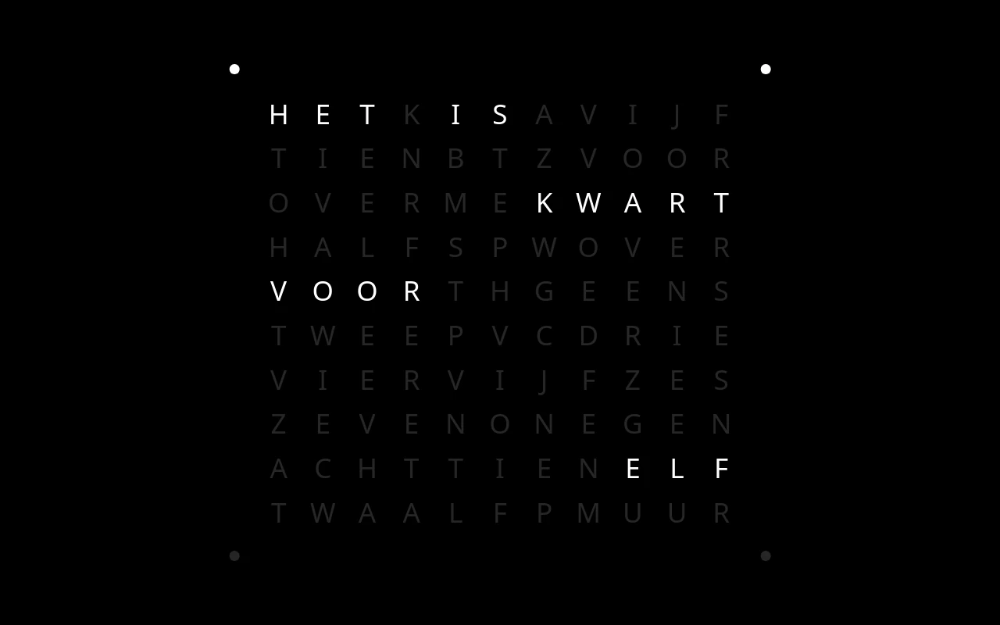<br><sub>Language: Nederlands</sub></td><td width="50%" valign="top">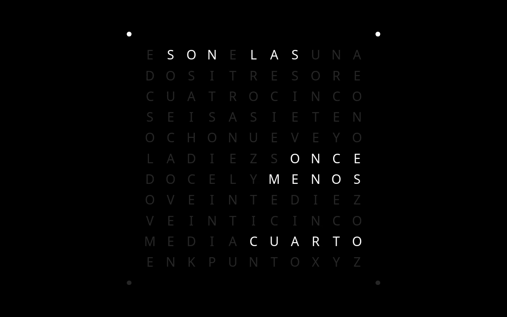<br><sub>Language: Español</sub></td></tr>
<tr><td width="50%" valign="top">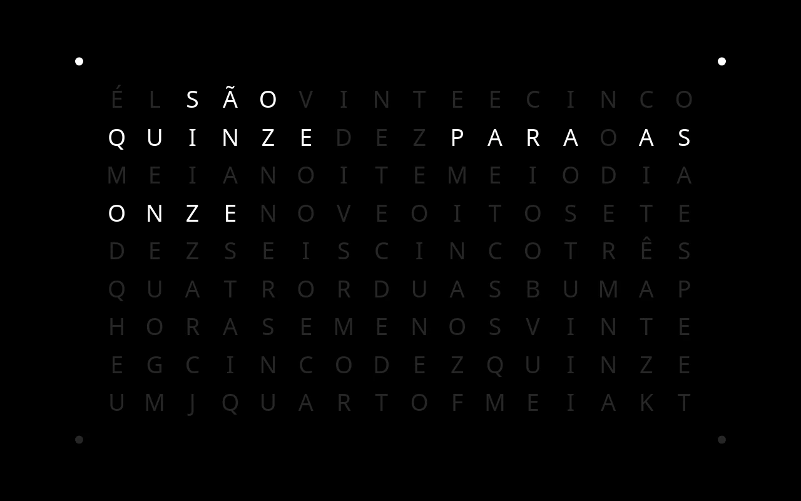<br><sub>Language: Português · Portugal or Brazil: Brasil (quinze, para as)</sub></td><td width="50%" valign="top">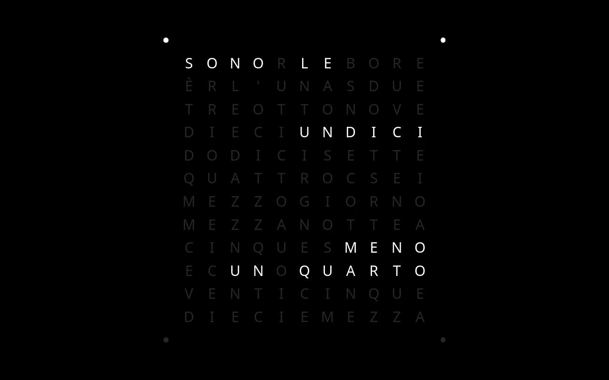<br><sub>Language: Italiano</sub></td></tr>
<tr><td width="50%" valign="top">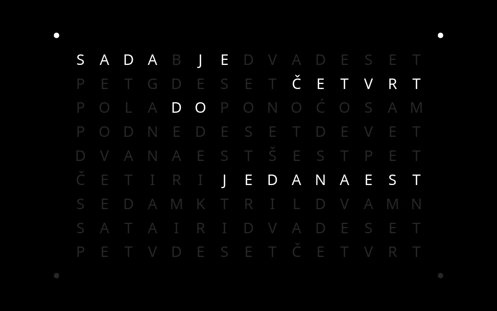<br><sub>Language: Srpski (latinica)</sub></td><td width="50%" valign="top"><br><sub>Language: Српски (ћирилица)</sub></td></tr>
<tr><td width="50%" valign="top">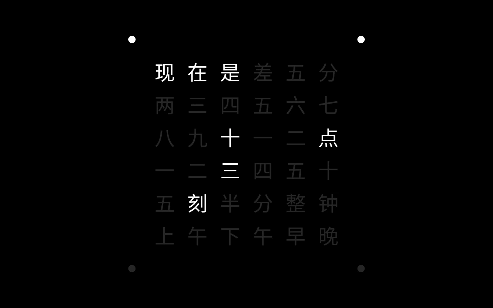<br><sub>Language: 简体中文</sub></td><td width="50%" valign="top">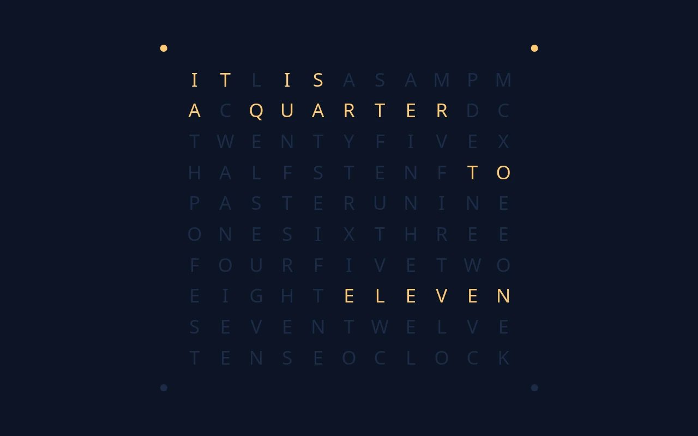<br><sub>Lit letters: #FFC872 · Unlit letters: #1D2B45 · Background: #0B1426</sub></td></tr>
<tr><td width="50%" valign="top">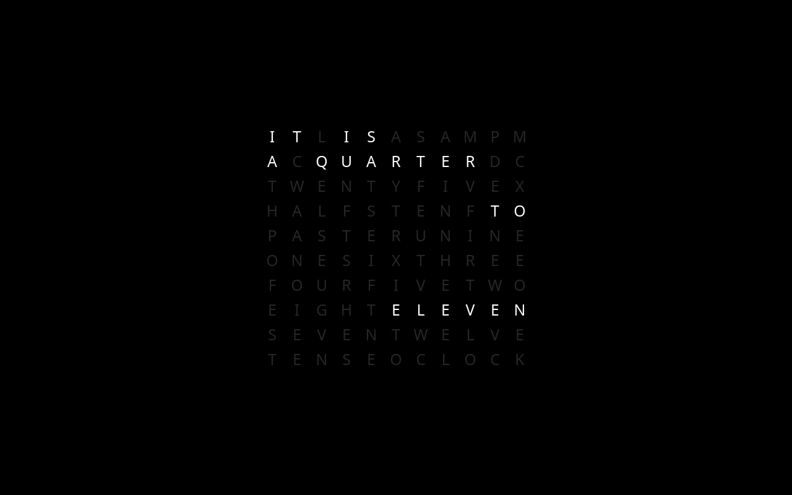<br><sub>Size: 60 % · Minute dots: off</sub></td><td width="50%" valign="top"><br><sub>Language carousel: on · Change every: 5 minutes · Carousel languages: English, Français, Deutsch</sub></td></tr>
<tr><td colspan="2" align="center">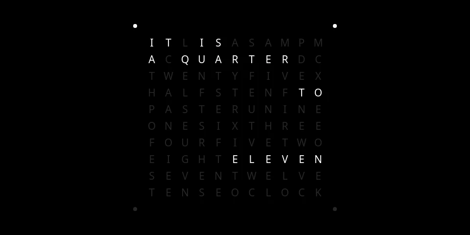<br><sub>960 × 480 screen · Every setting at its default</sub></td></tr>
</table>

All at 10:47, with Slow drift off; every other setting at its default. Regenerate with `python3 tools/screenshots.py`.
<!-- screenshots:end -->

## Languages

| Language | Grid | Usage choices |
|---|---|---|
| English | 11×10 | |
| Français | 11×10 | |
| Deutsch | 11×10 | *viertel nach drei, viertel vor vier* (default) or *viertel vier, dreiviertel vier* |
| Nederlands | 11×10 | |
| Italiano | 11×12 | *mezzogiorno, mezzanotte* (default) or *sono le dodici* |
| Español | 11×11 | *son las tres* (default) or *son las tres en punto* |
| Português † | 16×9 | *Portugal (um quarto, menos)* (default) or *Brasil (quinze, para as)* |
| Srpski (latinica) † | 15×9 | |
| Српски (ћирилица) † | 15×9 | |
| 简体中文 | 6×6 | *一刻, 三刻* (default), *四十五分* or *差五分* |

† Unverified: the wording still waits for a native speaker's check.

A language is data, not code: a grid, the words as cells, and a sentence for each five minutes. [Adding a language](docs/adding-a-language.md) says how.

## Settings

Under **Plugin Manager → Literal Clock**:

- **Language**, and that language's usage choice, if it has one;
- **Language carousel**: several languages in turn, in the order of the **Carousel languages** list (a language listed twice shows twice as often), changing every five minutes, on the hour or at midnight (**Change every**, one hour by default), with a short fade. Each language keeps its own usage choice. Off, or with no language in the list, **Language** applies;
- **Lit letters**, **Unlit letters** and **Background** colours;
- **Minute dots**: the corner dots, one for each minute past the five-minute step, clockwise from the top left;
- **Size**: how much of the screen the clock fills;
- **Slow drift**: moves the clock a little each minute, round a small circle once an hour.

Choose **Literal Clock** under **Screensaver → Screensaver mode**. Kiosk Satellite decides when the screensaver shows; the clock redraws once a minute and does nothing in between. The letters use the system font, so no font is shipped.

## Requirements

Android 7.0 or newer, on any device where Kiosk Satellite can show a screensaver. (An Echo Dot running Kiosk Satellite has no screen, so no screensaver.) Kiosk Satellite 2026.10.23 or newer.

## Installation

### Community Plugins (Recommended)

Literal Clock is listed in [Community Plugins](https://kiosksatellite.com/plugins/). Use the button below to open it in your Kiosk Satellite and install it.

[](https://kiosksatellite.com/redirect/plugin/?repository=missing-foss/literal-clock)

Or search for `Literal Clock` in **Settings > Plugin Manager > Browse plugins** in Kiosk Satellite.

### Manual

1. Open **Settings > Plugin Manager** in Kiosk Satellite and turn on **Enable Plugins**.
2. Choose **Add plugin**, paste `https://github.com/missing-foss/literal-clock` and choose **Preview**.
3. Review the plugin and choose **Trust and install**.

### From a ZIP

For testing, build the ZIP (below) and use **Plugin Manager → Developer Tools → Install from ZIP**. Each CI run also keeps the package as its `literal-clock-plugin` artifact; the downloaded file installs as it is, without unzipping.

## Data

Literal Clock sends no data anywhere: it reads only its own files and makes no network request.

## Develop

You need Python 3, JDK 17 or newer, Node.js 18 or newer, and an Android SDK with a platform and build-tools (`ANDROID_HOME` set).

```sh
python3 tools/test.py                            # every test
python3 tools/build.py --android-platform 35     # dist/literal-clock-<version>.zip
```

`tools/test.py` runs:

- the plugin against the SDK;
- the clock for every minute of the day in every language and usage, against the reviewed sentences in `tests/expected/`;
- the build tools' own tests.

`tools/screenshots.py` renders the Screenshots above from `assets/clock/` at a fixed time, and rewrites their captions from the settings each shot uses. It needs Chromium (or Chrome) and ffmpeg with libwebp; run it again when the face changes.

The screensaver itself is `assets/clock/`: an HTML page, with `wordclock.js` turning a time into lit cells. The Java plugin only publishes the page with its settings.

The icon's source is `art/icon.svg`. Render it with `rsvg-convert -w 256 -h 256 art/icon.svg -o assets/icon.png` (it needs the DejaVu Sans Bold font).

## Support

Literal Clock is free. If it keeps good time on your wall and you'd like to support its development, you can on [Ko-fi](https://ko-fi.com/missingfoss).

## Licence

[Apache-2.0](LICENSE), as the plugin template and SDK it builds on.
